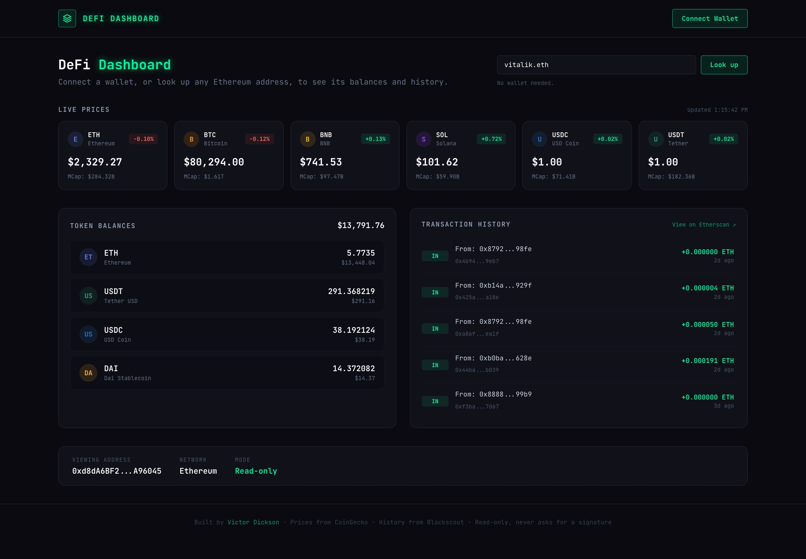

# DeFi Dashboard

A read-only Ethereum dashboard: live token prices, a wallet's balances priced in dollars, and its recent transactions. Connect MetaMask, or look up any address or ENS name without a wallet.

**Live:** https://vicintel.github.io/defi-dashboard/ (try the `vitalik.eth` sample)



Built with Next.js 14 (App Router, static export), ethers v6 and Tailwind CSS.

## What it does

- **Wallet connect or lookup.** MetaMask through `ethers.BrowserProvider`, or type any `0x` address or `.eth` name. ENS names resolve on mainnet.
- **Live prices.** ETH, BTC, BNB, SOL, USDC and USDT with 24h change and market cap from CoinGecko, refreshed every minute.
- **Token balances.** ETH and ERC-20 balances (USDT, USDC, DAI, WBTC, LINK) read straight from the mainnet contracts, each priced in dollars, with a total.
- **Transaction history.** The 20 most recent transactions, in or out, with failures marked and links to Etherscan.

## How it's put together

It runs entirely in the browser, so it can be hosted as static files with no server and no API keys:

```
lib/coingecko.js   prices from CoinGecko's public API
lib/chain.js       balanceOf and ENS reads through a public RPC node (PublicNode),
                   transaction history from Blockscout's Etherscan-compatible API
app/page.js        one price feed shared by the price cards and the balance totals
components/        Navbar, AddressLookup, PriceCards, TokenBalances, TransactionHistory
```

Each panel drops a reply that arrives for an address you've already moved away from, so switching quickly between wallets never shows the wrong one's data.

## Running it locally

```bash
npm install
npm run dev
```

Open http://localhost:3000. No environment variables are needed.

To build the copy that runs on GitHub Pages:

```bash
PAGES_BASE_PATH=/defi-dashboard npm run build   # static site in out/
```

## Notes

- Read-only. It never asks for a signature, never sends a transaction and never touches private keys.
- Ethereum mainnet only.
